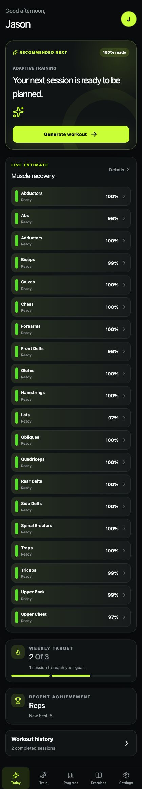
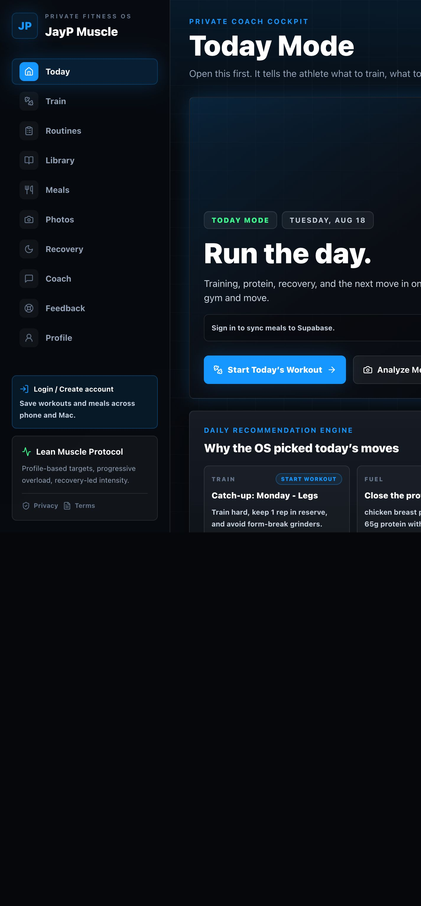
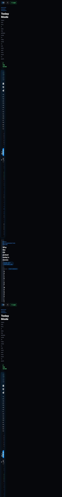

# TrainOS + Muscle OS — Full QA and Fitbod Benchmark

**QA date:** August 18, 2026  
**Scope:** source review, automated checks, responsive browser testing, primary user journeys, persistence, offline behavior, accessibility spot checks, and a comparison against Fitbod's current official product documentation.  
**Change policy:** read-only product review. No application source code was changed.

## Executive verdict

TrainOS is the stronger and more reliable workout product today. Its adaptive workout generation, per-muscle recovery, active workout flow, RIR/rest tracking, exercise substitutions, history editing, PRs, local persistence, export/import, and offline-first architecture make it the closer Fitbod alternative. Its automated suite is green and its tested mobile routes remained responsive.

Muscle OS has the broader and more differentiated product vision: workouts, meal/macronutrient logging, recovery check-ins, AI meal tools, an AI coach, progress photos, routines, custom exercises, and Supabase-backed accounts in one system. Its desktop presentation is strong, but three release-critical issues currently make it less dependable on a phone: the Today dashboard overflows horizontally, offline deep links silently display the dashboard, and incomplete weighted sets can be saved as completed. It also has no automated test suite.

The best product path is to make the TrainOS recommendation/logger/recovery engine the canonical training module, then layer Muscle OS's accounts, nutrition, routines, custom exercises, coach, and progress-photo features around it. That produces a credible training core plus an integrated health experience that Fitbod does not currently center.

## Release decision

| Product | Recommendation | Rationale |
|---|---|---|
| TrainOS | **Beta-ready after set validation** | Automated checks, manual flows, persistence, mobile responsiveness, and offline behavior passed. Prevent blank/incomplete weighted sets from being completed before broad release. |
| Muscle OS | **Hold mobile release** | Fix Today-page overflow and offline routing first; add set validation and automated coverage before relying on it for real workout data. |

## Findings by priority

### P1 — Muscle OS Today dashboard is broken at phone width

At a 375 px viewport, `/dashboard` expanded to approximately 699 px while every other tested Muscle OS route stayed at 375 px. The main Today panels became very wide, forcing horizontal scrolling and collapsing the perceived content area.

- Reproduced on the core post-login landing page.
- The grid at `components/today-mode.tsx:351` allows its children to retain their min-content width; the seven-day timeline is the most visible contributor.
- Add `min-w-0` to the responsive grid tracks/panel wrappers and retest at 320, 375, 390, 430, tablet, and desktop widths.
- Evidence: [Muscle OS mobile screenshot](qa-muscle-os-mobile.png).

### P1 — Muscle OS offline deep links render the wrong route

The service worker's navigation fallback always returns the cached dashboard when a requested navigation fails. Offline visits to `/settings` and `/routines` kept those paths in the address bar but rendered **Today Mode**.

- `public/sw.js:30` falls back to `caches.match('/dashboard')` for all failed navigations.
- The app shell omits several navigable routes, including routines, library, settings, and login.
- Fetched static assets are not added to the runtime cache.
- Cache route-specific shells or use a deliberate offline page; never show dashboard content under another route's URL.

### P1 — Both products accept incomplete weighted sets

In Muscle OS, pressing **Done set** without entering a weight marked the set complete, advanced the set pointer, started the rest timer, and persisted the workout. Default reps plus a zero weight still meet its logged-set predicate. TrainOS's completion handler has the same missing validation in source.

This can corrupt volume, progression, recommendation, recovery, and PR calculations. Require the fields appropriate to the exercise type before completion: for weighted lifts, at minimum a valid positive load and rep count; for bodyweight/timed/distance exercises, use type-specific rules. Provide an inline error and keep keyboard focus on the missing field.

### P1 — Muscle OS has no automated product tests

Lint, type checking, and the production build pass, but the project has no `test` script or dedicated unit/integration/end-to-end test files. The current mobile, offline, and logging issues are exactly the kind of regressions a small high-value suite should catch.

Start with:

1. Workout set validation and save/restore behavior.
2. Today page responsive-width assertions.
3. Offline navigation for every primary route.
4. Meal and recovery calculations.
5. Authentication gates and local-to-cloud synchronization.

### P2 — Muscle OS briefly shows stale workout content after save

After saving the Legs workout, the global split/header advanced to Pull but the old Legs lift board and next-set content remained visible until reload. The stored state was correct after reload, so this is a post-save synchronization/rendering issue rather than data loss.

### P2 — Two Muscle OS icon buttons lack accessible names

The visible icon-only Coach send button and Routines create-folder button had no accessible name during the route scan. Add an `aria-label` or visible label. TrainOS had no visible unlabeled buttons in the same scan.

### P2 — Muscle OS PWA icon coverage is incomplete

The manifest advertises only an SVG icon with `sizes: any`. Add purpose-appropriate 192×192 and 512×512 PNG icons, including a maskable icon, and validate installation on iOS and Android.

## TrainOS test results

### Automated

| Check | Result |
|---|---|
| ESLint | Pass |
| TypeScript | Pass |
| Unit/component tests | **31/31 passed across 7 files** |
| Coverage | 86.35% statements, 72.03% branches, 84.90% functions, 88.97% lines |
| Production build | Pass |
| PWA build | Pass; 54 precache entries, approximately 946 KiB |
| Playwright CLI | Environment limitation: Chromium was denied by the macOS process sandbox before test logic ran. Equivalent flows were exercised manually through the app browser. |

### Manual journey

- Loaded the recommended Pull Strength workout and reviewed recovery.
- Resumed an existing workout, added an exercise from the picker, logged load/reps/RIR, and confirmed the rest timer.
- Reloaded mid-workout and confirmed the completed set, six-exercise plan, and entered weight persisted.
- Finished the workout, submitted positive feedback, and confirmed recovery, weekly totals, history, PRs, and achievement updates.
- Opened workout history detail, entered Edit mode, and saved successfully.
- Checked the exercise library: 231 total exercises, 48 available under the configured gym filter, and 9 results for “bench.”
- Opened exercise detail, exported a backup, and opened/cancelled the destructive reset dialog.
- Checked all primary routes at 390 px: Today, Train, History, Progress, Exercises, and Settings remained width-safe.
- No browser console errors or warnings were observed.

## Muscle OS test results

### Automated

| Check | Result |
|---|---|
| ESLint | Pass |
| TypeScript | Pass |
| Production build | Pass; 28 routes generated successfully |
| Automated tests | **Not present** |
| Runtime note | Package requests Node 22; checks ran under Node 24 and emitted an engine warning. |

### Manual journey

- Reviewed the desktop Today dashboard and every primary mobile route.
- Started the Catch Up Legs workout, demonstrated the blank-weight completion defect, entered 135 lb, and saved the workout.
- Reloaded and confirmed the next Pull split and new 9-lift/30-set workout were stored correctly.
- Added a manual meal with protein, calories, carbohydrates, and fat; daily targets updated.
- Saved an 8-hour recovery check-in with soreness, stress, energy, and hydration; the score updated to 84.
- Searched the 120-exercise library and inspected the empty routines planner.
- Confirmed Smart Fill and Coach require authentication; authenticated Supabase synchronization and live AI output were therefore outside this run.
- Found no browser console errors or warnings.
- Confirmed the offline routing failure for Settings and Routines.

## Fitbod comparison

The Fitbod benchmark is based on current official documentation rather than a signed-in native-device test. Fitbod says its recommendations use workout history, goals, muscle recovery, available equipment, profile settings, time, split, variety, and exercise feedback; users can also edit, replace, reorder, and exclude exercises. Its official library describes more than 1,600 exercises with professional videos and over 80 equipment types. Fitbod also documents individual-muscle recovery, custom exercises, circuits/supersets, performance tracking, offline logging, and integrations with Apple Health/Watch, Health Connect, Wear OS, Fitbit, and Strava. Sources: [How Fitbod works](https://help.fitbod.me/hc/en-us/sections/360001078993-How-Fitbod-Works), [features and integrations](https://help.fitbod.me/hc/en-us/categories/1500000286421-Features-and-Integrations), [exercise library](https://fitbod.me/about-fitbod-exercises/), [progress tracking](https://help.fitbod.me/hc/en-us/sections/1500000536822-Progress-Performance-Tracking), and [offline use](https://help.fitbod.me/hc/en-us/articles/360006572594-Can-I-use-Fitbod-without-an-internet-connection).

| Dimension | Fitbod | TrainOS | Muscle OS |
|---|---|---|---|
| Adaptive workout generation | Category leader; many personalization inputs | **Strong** and closest Fitbod analogue | Basic/fixed JayP split templates |
| Muscle recovery | Individual muscle percentages and heatmap | **Strong:** 20 muscle groups with transparent readiness | One daily recovery score |
| Workout logging and editing | Mature before/during/after editing | Strong: RIR, rest, PRs, substitutions, history editing | Strong logger, but validation and stale-render defects |
| Exercise library and instruction | 1,600+ exercises, professional video, 80+ equipment types | 231 exercises; text/glyph instruction | 120 system exercises plus custom exercises; text-first |
| Progress | Mature strength estimates, records, goals, streaks | Good charts, volume, history, PRs, achievements | Good bodyweight, weekly metrics, and progress photos |
| Nutrition, AI, and photos | Not the product's central differentiator | Not present | **Clear leader:** meals/macros, AI tools, coach, photos |
| Cloud sync and wearables | Strong cloud and wearable/integration ecosystem | Local-only; export/import | Supabase account/sync architecture; no wearables observed |
| Offline and privacy | Strong hybrid offline workflow | **Strongest local-first posture** | Partial PWA; offline routing currently incorrect |
| Current QA readiness | Mature commercial product | Green automated suite plus successful manual run | Build checks green, but no test suite and mobile blockers |
| Ownership/cost | Subscription; official US pricing lists $15.99 monthly or $95.99 annually | Fully controlled local product | Fully controlled infrastructure/product |

Fitbod pricing source: [official subscription documentation](https://help.fitbod.me/hc/en-us/sections/1500000506081-Subscriptions). Regional pricing can differ.

## Product gaps and opportunities

### TrainOS versus Fitbod

TrainOS already covers the important workout loop unusually well. Its largest competitive gaps are cloud synchronization, account portability, exercise depth and video instruction, wearable/health integrations, custom exercises, and a more data-rich progression model. The local-first/privacy position is valuable and should remain a deliberate product promise rather than an implementation detail.

### Muscle OS versus Fitbod

Muscle OS wins on breadth, especially meals, recovery journaling, AI assistance, progress photos, and the single Today cockpit. It trails on the depth of training adaptation: its split is more template-driven, recovery is scalar rather than muscle-specific, and equipment/goal/history inputs do not appear to shape exercise selection at Fitbod's level.

### Combined opportunity

1. Reuse one canonical workout plan, logging, exercise, history, and recovery data model.
2. Put TrainOS's adaptive engine and muscle recovery behind Muscle OS's account-aware shell.
3. Keep local-first operation, then synchronize through an explicit conflict-safe queue when signed in.
4. Add Muscle OS routines/custom exercises, nutrition, coach, and photos as adjacent modules.
5. Expand instruction quality selectively: prioritize professional media for the highest-usage lifts before chasing library count.
6. Add health-platform integrations only after logging correctness, migration, and test coverage are reliable.

## Recommended execution order

1. **Reliability:** fix Muscle OS mobile overflow and offline routing; validate completion fields in both products; resolve stale post-save workout state.
2. **Quality system:** add Muscle OS unit, integration, responsive, offline, and end-to-end tests; run them in CI with pinned Node/package-manager versions.
3. **Architecture:** define a shared training domain model and migrate one product at a time; do not maintain two independent recommendation engines.
4. **Account-aware local-first sync:** reconcile local TrainOS data with Supabase accounts through versioned records, idempotent writes, and visible conflict resolution.
5. **Fitbod parity:** custom exercises, richer progression estimates, workout notes, supersets/circuits, professional media, and health/wearable integrations.
6. **Differentiation:** integrate meal/recovery context into recommendations, with transparent user controls and an explanation of why each session changed.

## Test limitations

- Fitbod was compared using current official public documentation; no paid/signed-in Fitbod account or native wearable was used.
- Muscle OS authenticated synchronization, account recovery, row-level access control, and live AI responses were not exercised because no test credentials were provided.
- Destructive reset/import actions were not executed; their dialogs and non-destructive export path were tested.
- The TrainOS CLI Playwright runner could not launch Chromium in this host's macOS process sandbox. Browser-based end-to-end coverage was completed manually instead.
